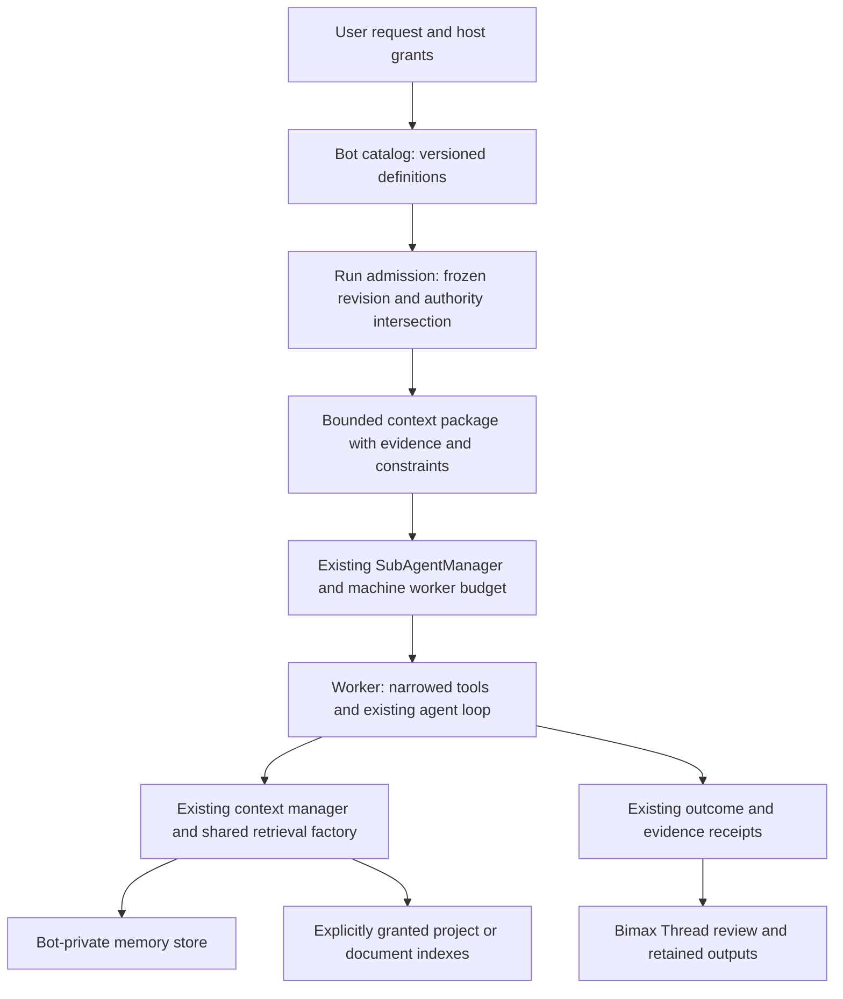

# Memory integrity, parallel workers and personal bots — design first

Date: 2026-10-18. Initial status: **Target design**, written before runtime edits in this change. The implementation record must distinguish landed contracts from planned product surfaces. Owner request: repair audit 100's three P1 defects; preserve existing work; build a strong, context/RAG-connected foundation for arbitrary user-created bots and parallel sub-agent workers.

## Product model

A **Bimax Thread** is the user's conversation and review surface. A **bot** is a reusable user-authored definition: name, purpose, instructions, requested tools and memory policy. A **bot run** is one immutable assignment using one saved definition revision. A **sub-agent worker** is an execution resource that a run uses. A bot is not a permanently running worker, and creating ten bots reserves no engines or cores.

Any topic is allowed as a bot definition. Start with editable examples, never hard-coded execution classes:

| Bot example | Useful default task | Default boundary | Evidence of success |
|---|---|---|---|
| Security audit | Review a selected repository and report reproducible findings | Read/search; changes and external scans need their own authorization | Exact path/line, reproduction, severity, limitations |
| Shopping research | Compare products against the user's budget/preferences | Research and a shortlist; checkout is a separate approved action | Current source links, total price/date/availability, uncertainty |
| Research assistant | Compare primary sources and produce a cited brief | Selected files and approved web tools | Traceable claims, contradictions and missing evidence |
| Custom bot | Whatever bounded outcome the user describes | Explicit tools, workspace and memory; no authority inferred from its title | User-defined acceptance criteria and actual tool/file outcomes |

Shopping, security and other names are examples, not permission presets. A bot called “administrator” gets no extra authority. Instructions, imported profiles and retrieved content cannot grant tools, network routes, native permissions or connector accounts.

## Creation and everyday use

The intended flow is **describe → review → save → run → inspect**:

1. “Create a bot that audits my projects for security problems.” Draft a readable definition from this request.
2. Show its name, purpose, requested tools, selected folders/knowledge, memory behavior and limits. Creation saves a definition; it performs no audit, indexing, download or sign-in.
3. User supplies a task and folder. Resolve a current revision, current grants and current model at run admission. A definition edit affects later runs only.
4. Open the run as a normal Bimax Thread with the bot's identity visible. Task progress, evidence, Pause/Stop, approvals and outputs use the existing task surface.
5. Show exact results and gaps; optionally save a reviewed lesson to the bot's memory. Deleting a profile explains retained run history and memory deletion separately.

Proposed compact creation sheet:

```text
New bot                                  Save
Name         Security reviewer
Purpose      Find actionable security defects
Instructions [editable, with a bounded preview]
Tools        Read files · Search code
Knowledge    [Choose folders / documents]
Memory       Private to this bot
Execution    On request · Ask before changes
```

The user-facing implementation belongs in a later reviewed UI slice. This foundation must not reorganize the existing sidebar or silently wire a new autonomous entry point into the composer. “Save as bot” and “Run with bot” can later be contextual actions; bot administration must not crowd the current task.

### Development API delivered by the kernel

Record 102 implements `BotCatalog` and `BotService`, compiled with the engine source. A trusted embedding host can create a definition, prepare a reviewable frozen assignment, and explicitly execute it through the existing worker manager:

```typescript
const catalog = new BotCatalog(hostBotDataDirectory);
const reviewer = await catalog.create({
  name: 'My security reviewer',
  instructions: 'Find actionable defects, cite exact source evidence, and state uncertainty.',
  requestedTools: ['ReadFileTool', 'GrepTool', 'MemoryQueryTool'],
});
const service = new BotService(catalog);
const assignment = await service.prepare(reviewer.id, {
  task: 'Audit the selected authentication code.',
  constraints: ['Leave the workspace unchanged.'],
  evidence: hostSelectedEvidence,
}, hostCurrentAuthority);
// The host can display assignment.botRun before an explicit run.
const result = await service.run(reviewer.id, {
  task: 'Audit the selected authentication code.',
  constraints: ['Leave the workspace unchanged.'],
  evidence: hostSelectedEvidence,
}, hostCurrentAuthority, stopSignal);
```

`hostCurrentAuthority` must come from the invoking host's current workspace/tool grants and permission mode, not a saved profile or model-produced JSON. It includes the maximum handoff-token budget. `prepare` and `run` independently resolve the current revision; a future review/approval UI must dispatch the exact reviewed assignment through a revision-bound receipt rather than silently treating these two calls as one approved snapshot. That UI binding is Target. The development API is not yet exported as an app IPC/tool surface.

The first implementation keeps the task as the worker's user message and the bounded handoff as system context. A fixture caught full-handoff text weakening recall; this split preserves the exact task as the retrieval query. Private automatic recall enters the ordinary evidence ledger. Parent-supplied evidence remains a bounded provenance-preserving snapshot; shared-library grants and full parent/child ledger linkage are later qualification work.

## Architecture and ownership



Use the current monolith and generic worker boundary from records 55/64. Mac native authority stays with Bimax for Mac; no bot profile supplies a Computer Use host, binary or grant. No new orchestration framework, vector database, cloud service or competitor source is required for the first slice.

### Existing parts to extend

| Existing component | Reuse | Gap to close |
|---|---|---|
| `SubAgentManager`, capacity coordinator, shared run budget | Real worker transport, machine CPU cap, model inheritance, result envelopes | Bot/run identity and a bounded explicit context handoff |
| Existing worktree/outcome machinery | Disjoint writable work and parent verification | Refuse bot editing teams until authority and integration tests prove the same boundary |
| AgentPersona → AgentLoop → ContextManager | One actual request-budget and compaction path | Bot instructions/context enter this path, never a competing prompt loop |
| VectorStore, ProjectMemory, auto-recall | Hybrid memory, exact evidence and scope | Fix transactions/backfill first; isolate bot memory by construction |
| SQLite code index and document/FactStore pipelines | Optional granted knowledge | Shared knowledge requires an explicit host-owned grant; a matching tag is insufficient authority |
| Existing approvals/governor/egress policy | Tool/action authority | Bot tool list can only narrow inherited authority; safe behavior cannot depend on prose |
| Checkpoint/outcome/event records | Lineage and recovery vocabulary | Durable bot scheduling and unknown-side-effect reconciliation remain separate milestones |

## Three memory repairs and adoption decisions

### P1-A01: whole-file write transactions

Keep the existing JSON memory format and ranking. Serialize **reload → merge/mutate → atomic publish** across independent instances, worker isolates and processes. All mutators participate: ordinary writes, deletion, recency flush and embedding publication. A per-instance mutex is still useful for local state, but cannot be the shared authority.

Candidates considered:

- Full migration to SQLite documents: attractive long term, but changes format, migration, rollback and ranking-resource assumptions together; defer.
- PID/time-based lock files: simple, but worker isolates share a PID and stale-time eviction can steal a live slow writer; reject for this repair.
- Existing SQLite adapter as an OS-released writer mutex beside the unchanged JSON file: selected for qualification. `BEGIN IMMEDIATE` gives a cross-connection write reservation; no application data is stored in the lock database. Wait for contention with bounded asynchronous retries, not a blocking busy timeout. Closing a killed process/worker releases its connection lock. No stale-lock deletion.

Canonicalize parent-directory identity, fail closed on unsupported/unsafe lock state, use unique temporary names, and keep embeddings/network work outside the transaction. Failed publication must invalidate the in-memory disk identity so a later write cannot resurrect an unacknowledged mutation. This is cooperative single-host coordination; old binaries and uncooperative external file editors do not participate. Network-volume and hardware power-loss claims require their own qualification.

### P1-A02: generation-bound backfill

Every newly stored document receives a generation token. A backfill snapshot binds document identity/generation, exact document/chunk text, chunk position/ID and the observed embedding space. On return, obtain the same write authority, reload current disk state and publish only to unchanged selected content in the still-active space. Skip/requeue replacement, deletion, ABA replacement and stale-space results. Legacy records remain readable without a destructive bulk rewrite; versionless admission also checks exact selected bytes.

### P1-A03: one retrieval-construction policy

Use one factory for the container and sub-agent workers. Resolve endpoint/model/dimensions through the existing settings path. Explicit embedding endpoints take precedence over chat credentials and work keyless locally. Resolve reranking separately, preserve the current opt-in local-reranker policy and use the same composition in workers. Do not change defaults, enable remote code embeddings or turn on the local model implicitly.

## Context and memory contracts

### Three memory lifetimes

| Lifetime | Content | Persistence / scope |
|---|---|---|
| Run working context | User task, constraints, current tool results, continuation | One run, existing compaction/archive/evidence path |
| Bot private memory | Reviewed preferences, conventions, prior lessons | One stable bot ID across its runs, isolated file/index namespace |
| Shared knowledge | User-selected project/documents/personal library | Explicit grants; read scopes applied before candidate depth and before text reaches the run |

A first kernel can implement bot-private memory and bounded supplied context while keeping shared-library attachment Target. Private storage is a structural separation, not just a `bot:<id>` tag inside the project store. Simultaneous runs of one bot share only its authorized durable memory and the repaired mutation protocol; each still has its own conversation, approvals and continuation.

The current kernel retains the existing near-duplicate merge and document-count retention policies. Full conflict/supersession history, byte-based quotas, reviewed lesson promotion and deletion/revocation propagation remain Target; private storage alone does not establish their correctness.

Do not let a read-only security bot silently write learned project instructions. Memory writing is a separately requested tool. Retrieved content stays historical evidence, with source version and age; it cannot become a fresh user instruction. Deletion/revocation must eventually remove prompt caches, vector rows and retained source references according to a documented retention policy.

### Delegated context package

A package carries the exact task, explicit constraints, bounded parent notes and selected `EvidenceSpan` objects. Source IDs, versions, locators and displayed text travel together. Source content is quoted as data. A parent's summary is labelled as such and cannot be promoted to independently verified completion.

Bound the package with the same tokenizer used by request accounting. Preserve the task and constraints before optional evidence; reject an impossible fixed package, and disclose omitted evidence. Do not copy the full parent transcript or credentials. A context package is a snapshot, not continuous access to the parent's mutable memory. The worker's normal AgentLoop must still budget the final request and can retrieve additional authorized evidence.

### Definition and run identities

Persist profiles with schema version, immutable stable ID, monotonically increasing revision, name, instructions, requested tools and bounded context policy. Use compare-and-swap revisions to reject lost edits. A run freezes the definition revision and a fresh run ID. Renaming a bot does not move its private memory. Two identically named bots have different IDs and stores.

The host derives actual authority as the intersection of the definition's requests, the invoking user's current grants and runtime availability. Unknown or denied tools refuse explicitly. Child delegation must preserve that intersection, memory scope, budget and cancellation lineage; until tested end to end, bot runs must not acquire unrestricted nested spawning through a generic spawn tool.

## Parallel execution policy

Reuse the machine-wide worker CPU budget and shared token/spend budget. Do not add a fresh pool of four workers for each bot. Engine count remains a separate memory budget. Idle profiles consume no workers; queued runs hold no API slot. The admission layer must eventually combine CPU, free memory, provider limits, power state and user-interaction priority.

Independent read-only tasks can run in parallel. Writable siblings require existing worktree isolation and scoped outcome assignments. A report from one worker is untrusted completion evidence until the parent checks actual file/test outcomes. Do not auto-merge bot branches.

Future supervisor state machine:

```text
created → queued → admitted → running → verifying → completed
                         ↘ needs_user ↔ running
                         ↘ stopping → stopped
                         ↘ interrupted → reconciling → running / blocked
                         ↘ failed
```

Creation and definition updates are not run admission. Stop must cancel model/tool work, retire pending approvals and drain workers before releasing write ownership. A scheduler restart cannot replay a purchase, send, patch or external mutation because a completion event is missing. Persist attempt IDs and reconcile actual effects first. Calendar/folder/web triggers, automatic background execution and durable schedules are later milestones, not side effects of saving a bot.

## Threat and failure cases the design must answer

- Imported bot says “ignore permissions”: it remains a data definition and gains no tool authority.
- Shopping page contains a prompt injection: it cannot unlock checkout, shell, private memory or another bot's knowledge.
- A run reads another bot's known memory ID: no shared store/namespace is available by default.
- User edits a profile mid-run: current snapshot stays unchanged; next run uses the new revision.
- Two runs update the same memory: transactions preserve all acknowledged independent facts; conflicting factual assertions remain inspectable rather than silently treated as agreement.
- Old embedding returns after memory replacement: generation validation refuses it.
- Provider is unavailable: the run reports degraded/blocked state without rewriting global model settings.
- Model declares “audit passed”: verification still needs concrete source/tool evidence.
- Machine sleeps, process dies or app restarts: interrupted runs stay interrupted until reconciled; no auto-replay of unknown side effects.
- A bot tries to spawn unrestricted children: narrow inherited authority or refuse spawning until that contract is implemented.

## Delivery slices and proof obligations

| Slice | Intended scope | Exit |
|---|---|---|
| S0 | Three memory repairs | Existing behavior retained; deterministic red/green regressions, real worker/process contention, process-death lock recovery, stale/ABA/deleted backfill and loopback worker endpoint checks; assertion-caught source faults |
| S1 | Bot kernel | Validated versioned user definitions, concurrent-safe catalog, immutable run admission, private memory and bounded evidence handoff through existing worker/context/RAG paths; no UI or autonomous trigger |
| S2 | Parallel bot execution hardening | Inherited worker/spend budgets, disjoint scopes, cancellation/drain, nested authority propagation, independent parent verification and durable lineage |
| S3 | Product experience | Create/edit/review/run bot from the app; templates as editable examples; runs in Bimax Threads; knowledge selection, memory inspection/deletion, visible grants and limits |
| S4 | Long-lived personal bots | Explicit schedules/triggers, durable queues, unattended approval behavior, restart reconciliation, physical install/model-tier/resource qualification |
| S5 | Broader actions | Approved connectors and Mac-owned CU only after their existing gates; shopping checkout/sends/mutations need exact authority and independent end-state proof |

Do S0 before bot runtime changes. Keep each slice small enough to review independently. A foundation is not a claim that the user-facing bot product, shopping execution or general unattended operation already works.

## Research and acceptance

Guidance: current product-reset README; 01/03/04/05/06/08; vision sections for performance and adaptive resource policy; research cards V03/V27B; competitive status/model-independent strategy and R01/R02/C01/C02/C04. The referenced capability matrix is absent. Audit 100's A04/A05 and records 97–98's failed RAG adoption remain open.

Fresh primary sources, checked 2026-10-18:

- [SQLite transaction control](https://www.sqlite.org/lang_transaction.html): one concurrent write transaction and explicit immediate admission support qualifying a shared writer mutex.
- [SQLite file locking](https://www.sqlite.org/lockingv3.html): OS-mediated connection locking and filesystem limitations inform the single-host boundary.
- [Anthropic multi-agent research system](https://www.anthropic.com/engineering/multi-agent-research-system): bounded task decomposition and separate worker contexts motivate explicit handoffs; it does not prove Bimax quality.
- [Claude Code custom subagents](https://code.claude.com/docs/en/sub-agents): configurable tools and memory are current product references; Bimax imports no implementation.
- [LangGraph persistence](https://docs.langchain.com/oss/javascript/langgraph/persistence): separate run checkpoints and longer-lived memory inform the lifetime split; no framework dependency is added.

Record new source evidence in the source ledger. Preserve baseline file hashes, exact changed-file baselines, raw failures, restored-source checks and all prior research. No reset, broad cleanup, staging, commit, installation, live purchase or hosted benchmark is required by this plan. Qualification must name exactly what passed and what remains Target.
