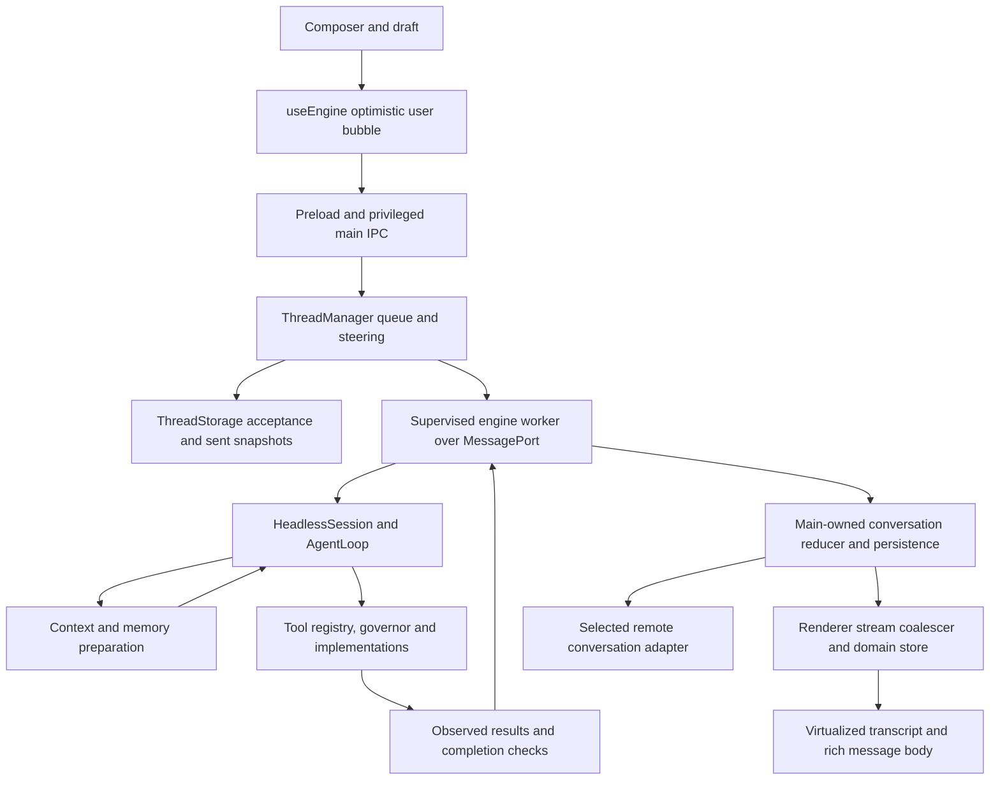

# 117 — Product depth, user experience and test gaps

Date: 2026-10-31. **Audit, not a runtime repair.** Scope: current dirty working tree at
`7d1346dd9f428ce780871a652ce2f3a27b5388f6`, including existing untracked implementation.
All new files are research/probes. Existing production source and tests were preserved.

## Assessment

Bimax has substantial implementation depth. Its engine workers, supervision, permissions,
memory coordination, context budgeting, worktrees, undo, stream coalescing, virtualized Desktop
transcript and independently executed completion checks are real mechanisms. Calling it only a
chat UI over an API would be inaccurate.

However, **having those mechanisms does not establish reliable composition**. This audit reproduces
four defects on active conversation/persistence paths, reconfirms two previously documented memory
defects, and finds two latent defects in retained API paths. The full ordinary Jest suite passes
while all eight corresponding adversarial contracts fail. This is evidence of missing contracts,
not a measured installed failure rate or a conclusion that every subsystem is defective.

The biggest deficit is reliable transitions between components: accepting a message versus recording
it, writing a snapshot versus replacing it, retaining a conversation versus loading it, and finding
a memory versus actually supplying its answer. Adding features or LOC will not close those gaps.

## What the size actually is

[Census method and per-file hashes](evidence/2026-10-31-depth-audit/census.json) enumerate deduplicated
tracked plus nonignored untracked regular source files. Dependencies are not traversed. Counts are
**physical lines including comments and blanks**, not executable statements or semantic complexity.
The inventory predates the later audit-probe additions, so reproducing it after this record adds
research/test lines; production counts should remain unchanged.

| Bucket | Files | Physical lines |
|---|---:|---:|
| First-party runtime, including native/UI styles | 707 | 126,721 |
| Tests and fixtures | 522 | 64,845 |
| Build and verification scripts | 141 | 13,831 |
| Benchmarks and design preview | 54 | 5,218 |
| Vendored or archived source | 133 | 35,721 |
| Other source, largely preserved research/evidence | 231 | 615,727 |

Runtime breakdown: engine **78,726**, Desktop/mobile renderer and host **42,656**, first-party native
**5,339**. The runtime bucket has 117,147 nonblank lines. This is already a substantial codebase.
One retained generated evidence bundle alone contributes **569,795** lines outside runtime.
`node_modules`, build outputs, vendored drivers and evidence copies must not be presented as owned
runtime depth. The census does not measure the separate mobile repository.

No other harness was counted under this same method. No current competitor size, quality ranking,
feature advantage or competitive Win is established here. Larger scope, repeated implementations,
generated bindings and platform support can all change counts; a count cannot establish maturity.

## Internal flow and the boundaries under test

Relevant inspected sources: `app/src/renderer/src/useEngine.ts`, `app/src/preload/index.ts`,
`app/src/main/index.ts`, `thread.manager.ts`, `thread.storage.ts`, `engine.ts`,
`src/protocol/headless.session.ts`, `src/core/agent.loop.ts`, `agent.tool.round.ts`,
`src/memory/context.manager.ts`, `recall.ts`, `src/outcome/completion.check.ts` and the responder adapter.
The current worker monolith supersedes the older two-repository/process diagrams. Mac capability
and permission ownership remain with the app; this audit changes no product boundary.

## Prioritized reproduced findings

All IDs below refer to [the executable desired contracts](evidence/2026-10-31-depth-audit/audit.contract.test.ts).
[Raw results](evidence/2026-10-31-depth-audit/audit-contracts.json) retain eight expected failures and
five passing controls. P1 means potential data loss/repeated work requiring prompt repair; P2 means
incorrect behavior or a narrower correctness gap. Priorities are audit judgments, not prevalence.

| ID | Priority / reachability | Observed end state | Repair direction |
|---|---|---|---|
| A01 | P1, active storage | A newly acknowledged queued input disappears after an older asynchronous rename finishes | One publication authority across immediate and coalesced writes |
| A02 | P1, active dispatch | A sent-state write failure leaves an executed request recorded as queued; restart dispatches it again | Durable admission before effect dispatch; explicit refusal/unsaved state |
| A03 | P1, active history | A successful >32 MiB snapshot save loads as zero conversations | Compatible write/read limits, segmented history and visible recovery |
| A04 | P2, active reducer with queued inputs | `first, second` becomes `first, second, first` on the first engine echo | Stable input identity and ordered optimistic-message adoption |
| A07 | P2, active memory; previously known | An unrelated zero-similarity note is injected despite zero lexical matches | Calibrated no-answer admission, with paraphrase-positive controls |
| A08 | P2, active memory; previously known | A matching long line loses the exact answering clause from its bounded excerpt | Span selection around the answer/relation at equal prompt budget |
| A05 | Latent, no current production callers found | App-owned approval promise remains pending after engine failure | Remove retired helper, or settle and delete callbacks on every lifecycle exit |
| A06 | Latent default-workspace option | One remote instruction creates two queued requests | Create empty then submit once, or use exactly one submitting creation path |

### A01 — the generation check is before an asynchronous commit

`app/src/main/thread.storage.ts:169–170` checks the written generation and then awaits `fsp.rename`.
`saveNow` independently performs a synchronous rename. The old rename can therefore be in flight
when the newer snapshot commits, and complete afterward. The old flush also assigns its older
generation back into `written`.

The probe pauses that asynchronous rename, saves and independently reloads the newer input, then
allows the old rename to complete. The final disk snapshot has lost the input. This is a controlled
legal I/O interleaving, not evidence of how often the filesystem schedules it in ordinary use.
The existing queue test pauses at `writeFile`, **before** the generation check, so it passes without
covering the later race. Merely adding another check after rename cannot undo overwritten bytes.

### A02 — an unsuccessful persistence boundary still permits execution

`app/src/main/thread.manager.ts:1116–1122` catches `saveNow` failure and substitutes a deferred save.
`pump` then sends the input regardless. The accepted queued snapshot can remain on disk while
the sent snapshot fails, violating the intended no-replay rule.

The real storage/manager probe injects an ENOSPC-style failure only for sent-state writes. It
observes one dispatch, reloads the actual queued snapshot before the deferred retry, and observes a
second dispatch on restart. Engine ports are spies; no real command or external effect executes.
The passing control records sent state successfully and observes zero replay. This qualifies a
local replay defect, not a complete installed C04/R01 journey or hardware power-loss experiment.

### A03 — successful writing and successful loading have incompatible domains

`saveNow` has no aggregate history-size admission; `load()` silently skips files above 32 MiB
(`app/src/main/thread.storage.ts:37–44`). A synthetic assistant history crossing that boundary saves
without error and then is absent from the loaded list. Its file still exists: the audit establishes
**invisibility on reload, not deletion**. Archived listing has a related size cutoff.

A writer must either retain a reloadable representation or explicitly refuse without acknowledging
success. Do not fix this by simply allowing unbounded synchronous startup parsing. Preserve a
bounded index and page retained history, with visible unavailable/corrupt/oversized states.

### A04 — optimistic reconciliation assumes the latest local bubble is the echoed one

`app/src/renderer/src/engine.state.ts:189–198` stops searching after the last user item even if it
is a different queued local input. Thus the first engine echo is appended after the second local
bubble. The reducer is also used by the main-owned conversation state, so the error is not limited
to a transient DOM rendering. Multi-input queues are supported by `ThreadManager.submit`; installed
timing/frequency of the visible duplication has not been measured.

### A07/A08 — memory retrieval is not answer sufficiency

These reconfirm audit 100 A04/A05; they are **not newly discovered or newly repaired**. Dense recall
asks for a zero score floor and disables lexical abstention whenever dense search is active
(`src/memory/recall.ts:123,139`). Controlled orthogonal vectors admit an orchard note for a quantum
physics question. This is a negative-control defect, not a real-embedding false-positive estimate.

`answeringExcerpt` chooses a matching line and, if too long, takes its beginning
(`src/memory/recall.ts:228`), dropping a fact near its end. A short-line positive control retains
the exact fact. Simply increasing every prompt would repeat the cost/quality problems of the
rejected candidates in records 97–98. Independent no-answer, long-line, temporal/update and
multi-source controls must precede another quality claim.

### A05/A06 — reachability changes the priority

`lifecycle` clears pending approvals before resolving the `hostCards` callbacks. `askOnBehalf` then
has a retained unresolved promise, while explicit Stop correctly resolves it. Repository search
found no present production caller of `askOnBehalf`; it is retained legacy machinery, not a proven
current approval-dialog hang. Prefer removal if it has no product purpose.

`RealEngineAdapter.sendInstruction` calls `create(root, instruction)` and then `submit(instruction)`.
The actual manager's `create` already submits a nonempty prompt, unlike the adapter test mock.
However, normal responder initialization passes `undefined` for `defaultWorkspaceDir`
(`app/src/main/responder/index.ts:50`). Consequently the duplicate branch is latent in normal
startup. Do not claim it explains ordinary selected-phone-chat duplication.

## Performance and code suitability

**Measured component cost:** immediate history saving serializes, writes and renames the entire
snapshot on the host event loop. Final warm temporary-filesystem medians for seven samples were
about 0.25 ms / 2.23 ms / 10.62 ms / 23.09 ms for 64 KiB / 1 MiB / 8 MiB / 16 MiB synthetic histories.
An idle-ready submit calls this path for queued acceptance and again for sent publication. This
is an architectural reason for history-size-dependent input/IPC delays. It does not establish the
owner's installed lag cause, native input latency, p95 across devices or a speedup.

**Source risk:** `userShellPath()` uses `execFileSync` on an interactive login shell with a five-second
timeout before worker creation (`app/src/main/engine.ts:22–28,220`). Slow shell initialization can
block main even though agent work itself runs in workers. No shell settings were changed and no
installed five-second stall was induced. An asynchronous, cached, cancellable environment lookup
is the candidate; grade first engine launch and menu/Stop responsiveness together.

**Measured repeated renderer work:** the actual production Markdown component lexes the entire
growing text before reusing stable tokens. At 256-character updates, a 131,072-character prose reply
caused 512 lexes totaling **33,619,968 characters**. The completed-token cache saves React subtree
work; it does not avoid lexing prior content. Fixed-size updates therefore accumulate quadratic
parse input as the reply grows. Nevertheless, the final six headless Chromium cases had **zero
updates over 16.67 ms**; the largest prose case's p95 was about 6.1 ms and max 6.7 ms. Code end
states retained exact bytes. An installed animation/typing stall was not reproduced by this probe.
Small messages may suit the present implementation; a more complex incremental parser must earn
its cost on representative long replies and preserve reference-definition/unfinished-fence semantics.

[Storage samples](evidence/2026-10-31-depth-audit/storage-performance.json) and
[renderer samples](evidence/2026-10-31-depth-audit/renderer-performance.json) contain every timing.
The first renderer invocation was invalid because Bun's `--outfile` collided with emitted CSS;
its receipt is preserved. Later valid runs use an output directory. Initial diagnostic logs remain;
final measurements were rerun after broad suites finished. These remain microbenchmarks.

**Build reproducibility gap:** `app/package.json:37` and its `desktop-responder` dependency use
absolute `/Users/vishsiddharth/Desktop/bimax-mobile/...` links, also present in the lockfile.
Both CI jobs run `npm ci` in `app` without provisioning that checkout/path. Local typecheck success
therefore depends on this workstation and does not qualify a clean hosted install. This is source
evidence; a fresh hosted runner was not executed. Use a portable versioned workspace/package contract,
then independently build Desktop with declared dependencies and regenerate the linked renderer.

**Maintainability:** `main/index.ts` is 2,974 lines, `ThreadManager` 1,129 and `AgentLoop` 1,147.
Size alone does not condemn them. The observed problem is that input admission, persistence,
lifecycle and UI projection have different authorities and failure semantics. Split around those
contracts only after reproductions protect them; cosmetic file splitting adds no product depth.
The declared lint command checks engine `src/**/*.ts`, omitting `app/`, and permits warnings. It
passes with **1,871 warnings**. That is a weak signal for Desktop code quality, not 1,871 UX bugs.

## Test cases to close, in order

These are proposed acceptance cases, not all newly implemented tests.

| Order | Scenario | Required independent result | Current evidence |
|---|---|---|---|
| 1 | Old async commit crosses urgent message save | Newest acknowledged input/bytes survive; generation never decreases | A01 red |
| 2 | Sent-state persistence fails; terminate before retry | No dispatch without durable admission, or no replay after restart | A02 red |
| 3 | Snapshot below/at/above retention boundary | Reloadable exact history or explicit refusal; never silent omission | A03 above-boundary red; lower control green |
| 4 | Several queued user inputs receive ordered echoes | One bubble per input ID, original order, same saved/remote view | A04 red; single-input control green |
| 5 | Unknown-topic dense recall and long matching lines | Abstain on unrelated evidence; retain answering clause within budget | A07/A08 red; lexical/short-line controls |
| 6 | Refused/stale/overlength ordinary send | Original draft retained; actionable rejection; no phantom accepted bubble | Source gap: fire-and-forget `engine:send`; end-state fixture Target |
| 7 | Engine death after side effect but before result event | Real fixture marker appears once after recovery, config/dirties preserved | Full installed C04/R01 Target |
| 8 | 1/50/200 conversations, large histories, two visible surfaces | Measured startup/switch/typing/Stop latency; bounded working memory | Installed workload qualification Target |
| 9 | Stream long Markdown while typing, scrolling and indexing | Exact final text/Copy; stable selection; frame/input budgets predeclared | Isolated component costs only |
| 10 | Stop during approval, auxiliary call, MCP and tool execution | No later authority/effect; all waits settle and resources drain | Existing scoped tests; complete installed journey Target |
| 11 | Sleep/wake plus provider/relay loss during work | Honest connection/run state, no duplicated effect, selected chat retained | Broad installed/device journey Target |
| 12 | Clean checkout and fresh Mac with no dev sibling folders | Install/build/first successful task using only declared setup | Absolute-link source gap; I01 Target |
| 13 | Minimum/balanced/frontier providers across tool/stream/compaction failures | Versioned route conformance, stable config and truthful outcomes | Current full live tier matrix unqualified |
| 14 | Retired helpers and optional remote creation branches | Remove unneeded paths or bind them to tested real implementations | A05/A06 latent red |

Start with persistence correctness, then retained-history/echo truth, then reproducible builds and
installed responsiveness measurements. Continue memory quality work under audit 100's equal-budget
and independent-judge rules. New autonomy/features should not substitute for C04/R01/R02/I01 gates.

## Verification and limits

| Check | Result |
|---|---|
| Engine and Desktop `tsc --noEmit` | Both pass |
| Focused existing Jest | 9 suites, 135 tests pass |
| Full current Jest, Node 24.15.0, two workers, no coverage | 480 suites pass, one skipped; 4,641 tests pass, three skipped |
| Declared Bun parity suite, Bun 1.3.14 | 133 pass across the two invocations, zero fail |
| Declared script tests | 3 pass |
| Declared engine lint | Zero errors, 1,871 warnings; Desktop excluded by script |
| Audit desired contracts, outside ordinary CI roots | Eight red, five green controls; intentionally retained failures |
| Real production Markdown in headless Chrome | Six valid component cases; zero browser errors; exact final code |
| Source preservation | 1,370 runtime/test/script files match census hashes |

Jest's three skips are the existing retired CU-memory-wiring case and two Bun-only real-reranker
cases. Bun runs its real-model checks separately. The ordinary suite count is not added to focused
tests, and separate runners are not combined into a product success rate.

Raw logs, assertions, scripts, samples, file hashes and the initial invalid browser attempt are in
[`evidence/2026-10-31-depth-audit/`](evidence/2026-10-31-depth-audit/). Tests use temporary synthetic
files, fake engine ports and controlled I/O scheduling. No live provider qualification, real message,
production configuration change, install/reinstall, package rebuild or deployment was performed.
No production-source fault mutation campaign was performed; expected failing regressions and
positive controls establish these observations, and repair-specific mutations remain required.

Guiding documents: product-reset README; 01 repo audit; 03 examples; 04 frontend plan; 05 architecture;
06 split history; 07 roadmap; 08 acceptance gates; Mac Buddy vision; 57 runtime/build plan;
competitive README/02/04/05/06 and C01/R01/I01 examples; current renderer record 116 and memory audit
100. The referenced `competitive/03_CAPABILITY_MATRIX.md`, P01 example and record 34 are absent.
Their stale references cannot qualify a capability. Old split/retirement prose was interpreted
chronologically against current source, with no legacy runtime reactivated.

**Status:** source audit and bounded local observations complete. All repairs, full installed
recovery/performance/security/device journeys, Product-ready, stable distribution and Win remain
Target or unmeasured. The docs are candid about many of these limits already; the danger is
promoting their scoped green checks into a broader confidence the evidence does not support.
